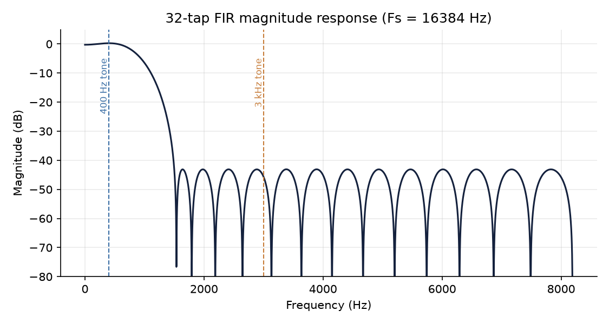
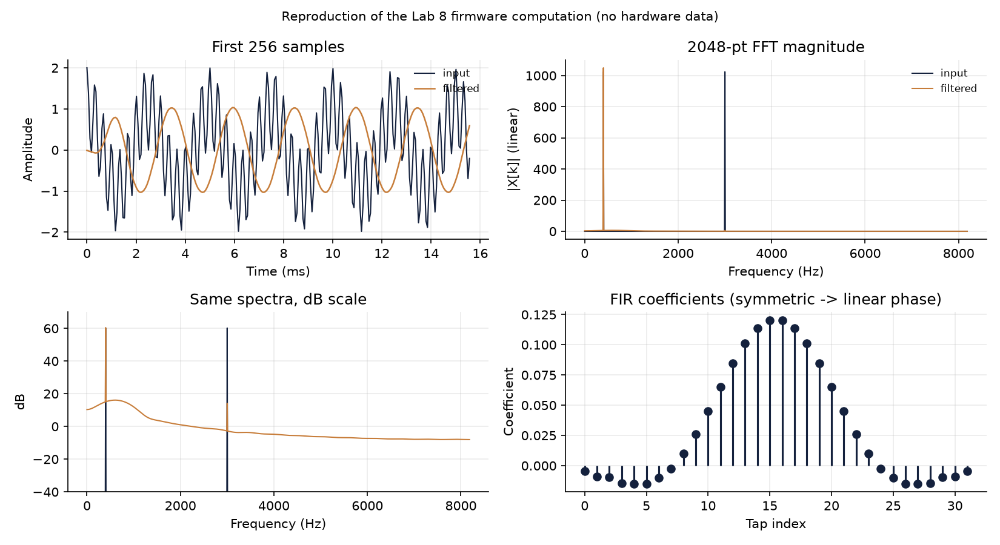

# FIR Low-Pass Filtering and FFT Analysis on an STM32 (CMSIS-DSP)

Firmware that filters a two-tone test signal with a 32-tap FIR low-pass filter and measures the result with a 2048-point FFT on a Cortex-M4F, plus a host-side reproduction in Python that checks the filter's behaviour numerically.

Lab 8 of CPE 3500 (Embedded Digital Signal Processing), Kennesaw State University, Spring 2026.

> **Scope of the evidence.** The firmware source is the author's working lab code. All numbers and figures below come from a **host-side reproduction** of its computation (coefficients and parameters are parsed straight from `main.c`). No hardware measurement is included: the `.bin` memory dumps saved from the lab did not match the firmware's expected outputs, so they were left out rather than presented as validation. See [Hardware validation](#hardware-validation).

## Engineering problem

Remove a high-frequency interferer (3 kHz) from a signal while keeping a lower-frequency component (400 Hz) intact, using a filter that runs in real time on a microcontroller, and verify the result in the frequency domain.

## Objectives

- Use CMSIS-DSP's `arm_fir_f32` with persistent state and block processing.
- Use `arm_rfft_fast_f32` and `arm_cmplx_mag_f32` to compute the magnitude spectrum before and after filtering.
- Choose the signal frequencies so each tone falls exactly on an FFT bin (no leakage).

## Method

| Parameter | Value |
|---|---|
| MCU | STM32L476RG (Nucleo), 80 MHz from HSI + PLL |
| Sampling rate (`SAMPLING_RATE`) | 16384 Hz |
| FFT length | 2048, so bin width = 8 Hz |
| Test signal | `cos(2π·400·n/Fs) + cos(2π·3000·n/Fs)`, generated on-chip |
| Filter | 32-tap FIR, symmetric coefficients (linear phase), applied in blocks of 32 |
| Outputs | Magnitude spectra of input and filtered signal (1024 bins each) and a frequency axis |

400 Hz and 3000 Hz sit exactly on bins 50 and 375, so a unit-amplitude cosine has magnitude N/2 = 1024 in the unnormalised FFT.

A symmetric FIR has constant group delay of (taps − 1)/2 = 15.5 samples = 0.946 ms at this rate.

```
main.c  →  arm_rfft_fast_init_f32 / arm_fir_init_f32
        →  generate input_signal[2048]
        →  for each 32-sample block: arm_fir_f32 → filtered_signal
        →  arm_rfft_fast_f32 + arm_cmplx_mag_f32 on input and filtered
        →  arrays inspected / exported from the debugger
```

The ADC, DAC and TIM6 are configured by CubeMX in the project but the lab code does not start them: the processing path uses the synthesised signal.

## Repository layout

```
firmware/Core/Src/main.c   lab application (generation, FIR, FFT)
firmware/Lab8.ioc          CubeMX configuration
tools/fir_fft_model.py     parses main.c; reproduces the computation
tools/make_figures.py      figures + results/summary.json
tests/                     7 pytest checks
results/                   generated outputs
```

## Run

```bash
python -m venv .venv && source .venv/bin/activate
pip install -r requirements.txt
pytest -q
python tools/make_figures.py
```

For the firmware, create a CubeIDE project from `firmware/Lab8.ioc` (CMSIS-DSP enabled), replace the generated `main.c` with the one in `firmware/Core/Src/`, build, and inspect `output_fft_mag_input`, `output_fft_mag_filt` and `output_freq` in the debugger's Expressions / memory view.

## Results (host reproduction)




| Quantity | Value |
|---|---|
| DC gain (sum of taps) | 0.970 |
| Gain at 400 Hz | 1.025 (1049.4 vs 1024 in FFT magnitude) |
| Attenuation at 3 kHz | −46.1 dB |
| Worst response at or above 2.5 kHz | −43.1 dB |
| −3 dB frequency | ≈ 858 Hz |
| Group delay | 15.5 samples, 0.946 ms |

Observations:

- The 400 Hz component passes with a gain slightly above 1 (passband ripple of this short filter), and the 3 kHz component drops from magnitude 1024 to about 5.
- The raised broadband floor below ~1 kHz in the filtered spectrum comes from the start-up transient: the filter state is zero, so the first 31 output samples are not steady-state, and the FFT's rectangular window turns that step into broadband energy.
- At 32 taps the transition from passband to stopband is gradual (−3 dB near 858 Hz, about −43 dB by 2.5 kHz). A longer filter or a windowed design with explicit specifications would give a sharper transition.

## Testing

`pytest` runs 7 checks: parameters parsed from the firmware, coefficient symmetry, block processing equal to direct convolution, tones on exact bins with N/2 magnitude, in-band gain, at least 40 dB attenuation at 3 kHz, and agreement with `scipy.signal.freqz`. All pass.

## Hardware validation

Not included. To complete it, run the firmware on a Nucleo-L476RG, export `output_fft_mag_input` and `output_fft_mag_filt` (1024 floats each), and add a script that overlays them on the model. Expected: peaks at bins 50 and 375 of magnitude ≈1024 for the input, and ≈1049 at bin 50 and ≈5 at bin 375 after filtering. Single-precision arithmetic on the board should agree to within roughly 1e-5 relative error. Any difference is a finding worth documenting.

## Limitations

- The test signal is synthesised; the project does not process analogue input.
- The coefficients appear to come from a filter-design tool, but the design specification (cutoff, window, tool) is not recorded in the source, so it is not stated here.
- Coefficients are parsed with a regular expression, which assumes the array layout in `main.c`.

## Lessons learned

- Placing test tones on exact FFT bins removes leakage and makes expected magnitudes (N/2) checkable by hand.
- Block-wise FIR with persistent state is equivalent to one long convolution. A test confirms it.
- Reproducing firmware math on a host gives a regression reference for later hardware work.

## Future work

- Capture real board output and add the overlay comparison.
- Process live ADC data via DMA and filter in the DMA half/full-complete callbacks.
- Fixed-point (`arm_fir_q15`) variant and cycle-count comparison with the float version.
- Design the filter from stated specifications with `scipy.signal.firwin` / `remez` and document the trade-off.

## Preparation note

The firmware (`firmware/`) is the author's own lab code. The host-side reproduction, tests, figures and this README were produced during portfolio preparation with AI assistance (Claude).

## License

MIT for original code. STM32Cube-generated files carry STMicroelectronics' license headers.
